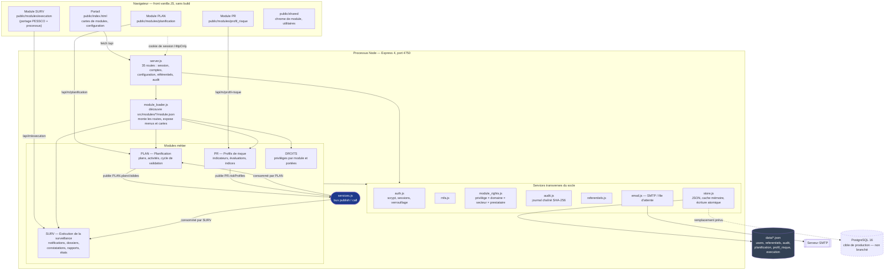
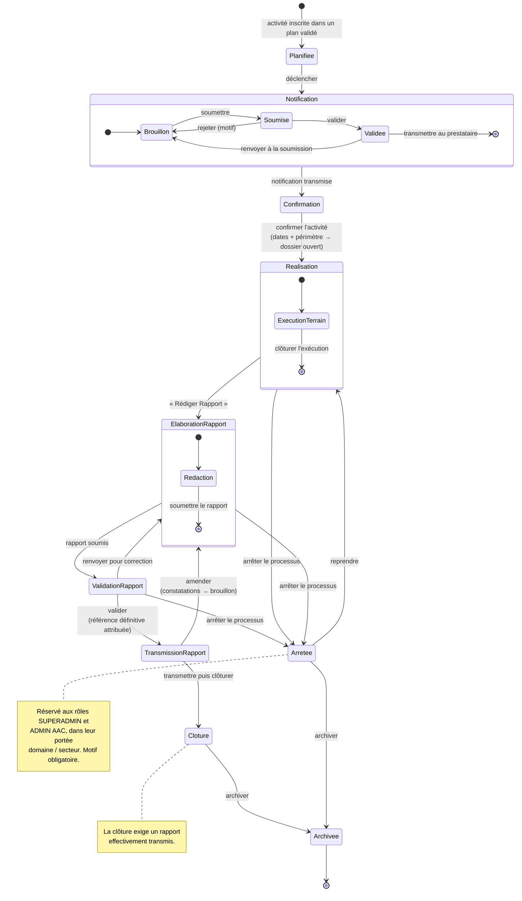
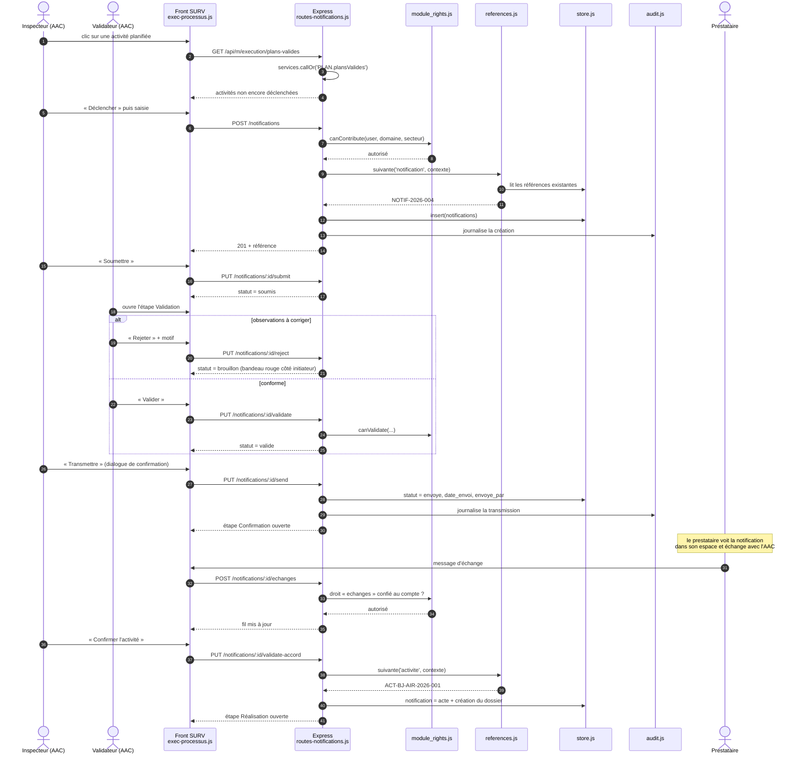

# OASIS — diagrammes UML

Vue d'architecture de l'application, tirée du code (août 2026).
Quatre diagrammes : composants, classes, états du circuit de surveillance, séquence d'un déclenchement.

Les blocs Mermaid se rendent dans GitHub, GitLab et VS Code (extension *Markdown Preview Mermaid*).

---

## 1. Diagramme de composants

Ce que le déploiement contient réellement : **un seul processus Node**, qui sert l'API et le front,
et **un seul port** (4750). Les modules sont découverts au démarrage et montés sur le même serveur
Express ; ils communiquent par un bus de services en mémoire, jamais par leurs fichiers de données.

**À retenir** — le couplage entre modules passe exclusivement par le bus : SURV lit les plans validés
via `services.callOr('PLAN.plansValides', [])`, jamais `data/planification.json`. C'est ce qui rend
l'activation d'un module indépendante des autres.

---

## 2. Diagramme de classes

Entités telles qu'elles existent dans les fichiers de données, avec leurs attributs porteurs de sens
métier (les champs d'horodatage et d'auteur sont omis sauf lorsqu'ils portent une règle).

```mermaid
classDiagram
    direction LR

    class Utilisateur {
        +String username
        +String nom, prenom, email
        +Role role
        +String prestataire_id
        +String[] modules
        +String[] droits_surv
        +String salt, hash
        +bool active, locked
        +int failedAttempts
        +authentifier()
        +verrouiller()
    }

    class DroitsModule {
        +String module
        +String username
        +Privilege privilege
        +Portee[] scopes
        +peut(action, domaine, secteur)
    }

    class Portee {
        +String domaine_id
        +String secteur_id
        +String prestataire_id
    }

    class Prestataire {
        +String id, nom, trigramme
        +String domaine_id, secteur_id
        +String point_focal, email_point_focal
    }

    class Secteur {
        +String id, code, nom
        +String domaine_id
    }

    class Domaine {
        +String id, code, nom
    }

    class Plan {
        +String id, titre, reference
        +int annee
        +String domaine_id, secteur_id
        +StatutPlan statut
        +int version
        +String parent_plan_id
        +soumettre() valider() rejeter()
    }

    class Activite {
        +String id, objet, titre
        +String prestataire_id, secteur_id
        +String type_supervision_id
        +String mode_supervision_id
        +Date date_debut, date_fin
        +String responsable_id
        +String[] themes_couverts
        +Priorite priorite
    }

    class Notification {
        +String id, reference
        +String activite_id, plan_id
        +String prestataire_id
        +String objet_activite
        +String perimetre_activite
        +Date date_activite, date_fin_effective
        +StatutNotification statut
        +bool hors_plan
        +bool arret, archive
        +String reference_activite
        +soumettre() valider() transmettre()
        +confirmer()
    }

    class Echange {
        +String id
        +String notification_id
        +String contenu
        +String auteur
        +Date date
    }

    class Dossier {
        +String id, reference
        +String notification_id
        +StatutDossier statut
        +Etape current_step
        +bool realisation_closed
        +bool redaction_closed
        +bool archive
        +String final_reference
        +cloturerRealisation()
        +soumettreRapport()
        +cloturer()
    }

    class Rapport {
        +String id, reference
        +String dossier_id
        +int version
        +StatutRapport statut
        +String contenu
        +String observations_validation
        +Date date_validation, date_transmission
        +valider() amender() transmettre()
    }

    class Constatation {
        +String id, reference
        +String dossier_id, prestataire_id
        +Criticite criticite
        +String description
        +String recommandation
        +String actions_correctives
        +Date date_due_cloture
        +StatutConstatation statut
        +soumettrePAC() solder()
    }

    class Evaluation {
        +String id
        +String prestataire_id
        +String secteur_id
        +Note[] notes_conf
        +Note[] notes_perf
        +Note[] notes_comp
        +Resultat resultats
        +String[] evaluateurs_designes
    }

    class EntreeAudit {
        +String ts, user, action
        +Object details
        +String prevHash
        +String hash
        +verifierChaine()
    }

    Utilisateur "1" --> "0..*" DroitsModule : reçoit
    DroitsModule "1" *-- "0..*" Portee
    Utilisateur "0..*" --> "0..1" Prestataire : rattaché à
    Prestataire "0..*" --> "1" Secteur
    Secteur "0..*" --> "1" Domaine

    Plan "1" *-- "0..*" Activite : contient
    Activite "1" --> "0..1" Notification : déclenche
    Notification "1" --> "0..*" Echange
    Notification "1" --> "0..1" Dossier : ouvre à la confirmation
    Dossier "1" --> "0..*" Rapport : versions successives
    Dossier "1" --> "0..*" Constatation
    Activite "0..*" --> "1" Prestataire
    Notification "0..*" --> "1" Prestataire
    Evaluation "0..*" --> "1" Prestataire : profil de risque
    Evaluation ..> Plan : oriente la planification

    note for Notification "hors_plan = activité déclenchée\nsans activité planifiée"
    note for Rapport "l'amendement d'un rapport validé\nremet ses constatations en brouillon"
    note for EntreeAudit "append-only : chaque entrée\nchaîne le hash de la précédente"
```

---

## 3. Diagramme d'états — circuit d'une activité de surveillance

Le cœur métier du module SURV. Chaque transition correspond à une action utilisateur confirmée par
une boîte de dialogue, et à une route serveur qui vérifie les droits et l'état de départ.

### Délais associés (Paramètres → Délais)

| Étape | Échéance par défaut | Point de départ |
|---|---|---|
| Déclenchement | 30 j **avant** | date de début de l'activité |
| Validation de la notification | 3 j | soumission |
| Confirmation par le prestataire | 7 j | transmission |
| Soumission du rapport | 15 j | fin de l'activité |
| Validation du rapport | 7 j | soumission du rapport |
| Transmission du rapport | 5 j | validation |
| Archivage du dossier | 30 j | clôture |

---

## 4. Diagramme de séquence — du déclenchement à la transmission

Un cas nominal, avec les contrôles de droits effectivement présents dans le code.

---

## Conventions de lecture

- **Rôles portail** : `SUPERADMIN`, `ADMIN` (Admin AAC), `AAC`, `ADMIN_PRESTATAIRE`, `PRESTATAIRE`.
- **Privilèges par module** : `GESTIONNAIRE`, `VALIDATEUR`, `CONTRIBUTEUR`, `LECTEUR`, plus `PRESTATAIRE` pour SURV — chacun assorti de portées domaine / secteur / prestataire.
- **Références** : composées à partir du modèle défini dans *Paramètres → Autres paramètres* (préfixe, code État issu du bigramme du portail, domaine, secteur, prestataire, année, mois, numéro d'ordre).
